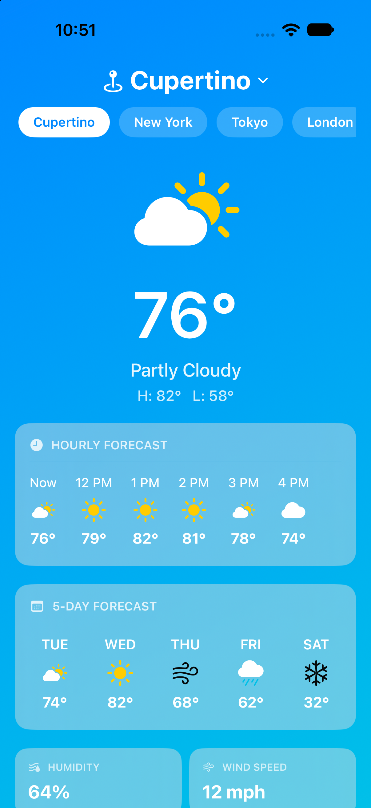

# ☀️ SwiftUI Weather App

A simple, beautiful, and beginner-friendly iOS Weather Application built with **SwiftUI**.




---

## ✨ Features

- 📍 **Location Selection:** Switch effortlessly between popular cities (**Cupertino, New York, Tokyo, London, Paris**) using quick-switch pills or the dropdown location menu.
- ⏰ **Hourly Forecast:** Horizontal scroll displaying temperatures and weather icons for upcoming hours.
- 📅 **5-Day Forecast:** Daily outlook featuring SF Symbols and high temperatures.
- 📊 **Detailed Weather Metrics:** Grid cards showing **Humidity**, **Wind Speed**, **Feels Like**, and **UV Index** with Apple's frosted glass style (`.ultraThinMaterial`).
- 🌙 **Day & Night Mode:** Toggle themes with animated gradient shifts that adapt to conditions.
- 💡 **Clean & Beginner-Friendly Code:** Modular architecture broken down into simple, reusable views (`LocationBarView`, `CurrentWeatherView`, `HourlyForecastCard`, `DailyForecastCard`, `WeatherMetricsGrid`).

---

## 📂 Project Structure

```text
SwiftUI-Weather/
├── SwiftUI-Weather/
│   ├── SwiftUI_WeatherApp.swift   # Main app entrypoint (@main)
│   ├── ContentView.swift          # Main UI, Models, and Modular Subviews
│   └── Assets.xcassets/           # App icons and color assets
├── SwiftUI-WeatherTests/          # Unit tests
├── SwiftUI-Weather.xcodeproj      # Xcode project file
└── weather_preview.png            # App screenshot
```

---

## 💡 Key SwiftUI Concepts Taught

1. **`@State` & `@Binding`:** Managing UI state for the selected city and day/night mode.
2. **Dynamic UI Updates:** How changing state automatically updates weather data, icons, gradients, and cards.
3. **Layout Stacks (`VStack`, `HStack`, `ZStack`):** Layering gradient backgrounds and organizing weather sections.
4. **Lists & Grids (`ScrollView`, `LazyVGrid`, `ForEach`):** Horizontal carousels for hourly forecasts and 2x2 grids for weather metrics.
5. **Apple SF Symbols:** Native vector weather icons (`sun.max.fill`, `cloud.rain.fill`, `moon.stars.fill`, etc.).
6. **Reusable Subviews:** Extracting components to keep code clean, readable, and easy to maintain.

---

## 🚀 How to Run in Xcode

1. Open `SwiftUI-Weather.xcodeproj` in Xcode.
2. Select any iPhone simulator (e.g. **iPhone 16** or **iPhone 15 Pro**).
3. Press **⌘ + R** to run, or press **⌥ + ⌘ + P** to interact with the live Canvas preview in `ContentView.swift`.
